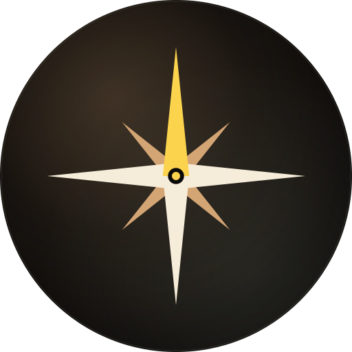
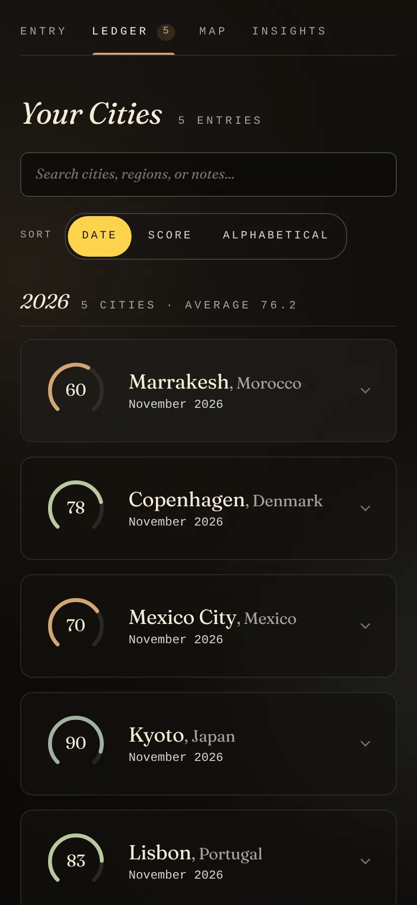
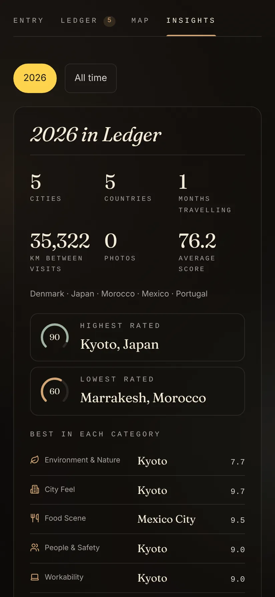
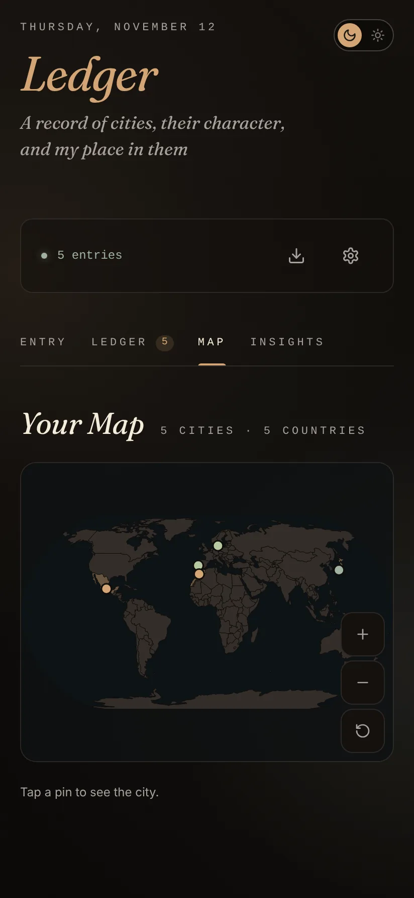
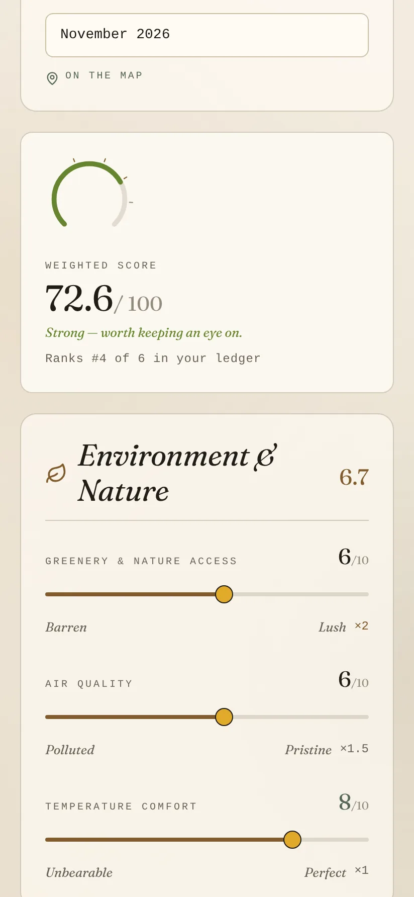

<p align="center"></p>

<h1 align="center">Ledger</h1>

<p align="center"><em>A record of cities, their character, and my place in them.</em></p>

<p align="center">
  Android&nbsp;·&nbsp;iOS&nbsp;·&nbsp;<a href="https://github.com/not-mehul/Ledger/releases/latest">Latest release</a>&nbsp;·&nbsp;MIT&nbsp;·&nbsp;Created by <strong>Mehul Sen</strong>
</p>

---

Ledger is a personal ledger of the cities you visit. Rate each one on metrics you choose and weight yourself, get a score out of 100, add notes and photos, see your travels on a map, and find out what you actually value in a place. Everything stays on the device: there are no accounts and no network calls.

<p align="center">
  
  
  
  
</p>

## Features

### Rate a city

- **Weighted scoring with a live dial.** The metrics are yours to rename, re-weight, reorder, hide or add, each with its own icon. Scores update everywhere and only count what an entry actually rated.
- **A form that knows your ledger.** As you rate, the score panel shows where the city would rank, each category shows its live average, and a city you have visited before offers to start from your last ratings.
- **City autocomplete, offline.** About 210,000 towns (every town of 1,000 people or more, plus every capital and seat), with old and English names too: "Bombay" finds Mumbai and "Bruges" finds Brugge. Picking one pins the entry where the town really is.
- **Photos** from the gallery or camera, with a full-screen viewer.

### See the pattern

- **A map** of visited cities and countries, offline, with pinch to zoom.
- **A year in review**: cities, countries, months on the road, distance, best and worst city and the winner of each category, with a shareable card.
- **Rankings** by overall score, any category or any single metric.
- **What you actually value.** Ledger compares each metric with how much you would return to a city and suggests weights that match.
- **Patterns**: your scores over time with a running average, how they spread across the tiers, and the metrics you rate most generously and most harshly.
- **Context on every entry.** Where the city ranks, where it most beats or falls short of your usual rating, and every visit to it with how its score moved.
- **Compare** two or three cities side by side, metric by metric, with a one-line verdict.
- **Small memories.** The ledger groups cities by year with a count and average, and reminds you where you were this month in earlier years.

### Keep it safe

- **Export** a full `.zip` backup with photos, or a readable Markdown summary. **Import** either, older JSON exports, and Travel Logbook exports. The most recently saved copy of each entry wins.
- **Automatic backups** to `Documents/Ledger/Backups` (daily, weekly or monthly, keeping the last few), plus Android's own backup of the ledger.
- **Undo** after deleting an entry, instead of a confirmation.
- **Share a city card** as an image.
- **Links from the other apps.** `ledger://add?city=Lisbon&country=PT&date=2026-10-02` opens a new entry with the place and month filled in. `ledger://open` just opens Ledger.

### Make it yours

- **Dusk and Dawn themes**, or follow the system.
- **English, Spanish, French and German.**
- **A little delight.** A flurry of passport stamps for your first city or a high score, an idle stamp to play with, and four easter eggs, counted in Settings. All of it respects reduced motion.

## Private by design

Ledger makes no network calls. Your ledger is one file in the app's private storage, with your photos beside it, and it only leaves the device when you export or back it up.

## Install

- **Android:** download the signed APK from the [latest release](https://github.com/not-mehul/Ledger/releases/latest) and open it on your phone.
- **iOS:** build it from source with Xcode (see below).

**Coming from Travel Logbook?** Ledger installs alongside it. In Travel Logbook tap **Export**, then in Ledger go to **Settings → Data & backups → Import** and choose `logbook.md`.

## The Dusk & Dawn apps

Ledger is one of six apps by Mehul Sen that share one design system, [Editorial Dusk & Dawn](https://github.com/not-mehul/dusk-dawn), and a common link scheme, so they can hand things to each other.

| App | What it is for |
|---|---|
| [Waymark](https://github.com/not-mehul/Waymark) | Your whole trip, offline: flights, stays, plans and costs on one timeline |
| [BookShelf](https://github.com/not-mehul/BookShelf) | Books, films, shows and the lines worth keeping |
| [Ledger](https://github.com/not-mehul/Ledger) | A record of cities, scored on what matters to you |
| [Colophon](https://github.com/not-mehul/Colophon) | Inspect, fix and rebind EPUB editions |
| [Rosetta](https://github.com/not-mehul/Rosetta) | A quiet library and reader for books, papers and notes |
| [Mise](https://github.com/not-mehul/Mise) | Recipes from anywhere, cooked one step at a time |

## Build from source

Svelte 5 and TypeScript, built by Vite, in a Capacitor 8 app for Android and iOS. You need Node 22.12 or later, plus JDK 21 and Android Studio for Android, or Xcode 16 for iOS.

```sh
npm install
npm run dev          # the app in a browser
npm run check        # tokens, lint, types and unit tests
npm run android      # build, sync and open Android Studio
npm run ios          # build, sync and open Xcode
```

[docs/DEVELOPMENT.md](docs/DEVELOPMENT.md) covers the requirements, scripts, tests, project layout, data format, releases and troubleshooting. [RELEASING.md](RELEASING.md) covers signed releases.

## Credits

Ledger is designed and built by **Mehul Sen** ([@not-mehul](https://github.com/not-mehul)).

- City data: [GeoNames](https://www.geonames.org), CC BY 4.0, shipped from the shared gazetteer in `dusk-dawn/places`.
- Map shapes: [Natural Earth](https://www.naturalearthdata.com) via `world-atlas`.
- Icons: [Lucide](https://lucide.dev), ISC.
- Fonts and design: Fraunces (SIL Open Font License) through [dusk-dawn](https://github.com/not-mehul/dusk-dawn).

## Licence

[MIT](LICENSE) © 2026 Mehul Sen. The bundled data keeps its own terms, listed above.
